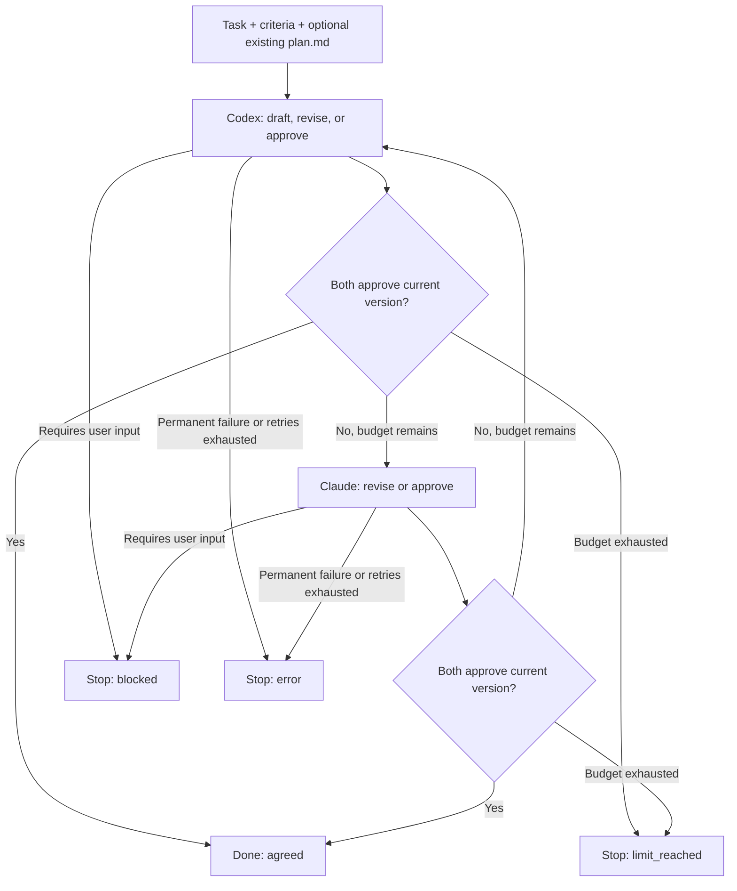

# Duo: automated plan review with LangGraph

## Objective

Automate the workflow of asking Codex and Claude to create, review, and update a project plan until both approve the same version.

Use LangGraph to alternate between Codex CLI and Claude Code, maintain the current plan in shared state, and control termination. Each agent can inspect the repository. Python validates proposed revisions and writes `plan.md`.

## Prerequisites

- `langgraph` installed in the orchestrator's Python environment.
- Codex CLI and Claude Code installed and authenticated.
- The target repository is a git repository. `codex exec` refuses to run outside one; if that is unavoidable, pass `--skip-git-repo-check`.

## Workflow



1. Start with the original task, fixed acceptance criteria, and an optional existing `plan.md`.
2. Ask the first agent to create a plan if none exists, or review the existing plan.
3. Validate the agent's structured response. Retry recoverable failures a bounded number of times; stop immediately on permanent failures.
4. Apply a substantive revision, record approval, or stop for a required user decision.
5. Alternate agents until both approve the current version, the turn budget is exhausted, or an unrecoverable error occurs.

Either agent may start; the example below starts with Codex.

Agreement takes at least 3 turns when no plan exists (draft, approve, approve) and at least 2 when reviewing an existing plan. `MAX_TURNS = 12` leaves room for several revision rounds.

## Review contract

Each agent returns a structured response:

```json
{
  "decision": "revise",
  "plan": "# Updated plan\n...",
  "reason": "Added the missing migration and rollback steps."
}
```

Supported decisions:

- `approve`: accept the current plan without changes. Return an empty `plan` field.
- `revise`: return the complete updated plan and explain the substantive changes.
- `blocked`: identify a necessary decision that requires user input, stated in `reason`. Return an empty `plan` field.

Whenever the plan changes, clear both approvals. Creating or editing a plan does not count as explicit approval. Both agents must approve the same unchanged version before the workflow reports agreement.

Normalize only line endings before comparison. Preserve indentation, trailing spaces, and blank lines, including at the end of the file: these can be part of Markdown or embedded code. Reject revisions whose text is unchanged after line-ending normalization. Do not use `rstrip()` to decide equality; it also discards Unicode whitespace such as non-breaking spaces. This comparison cannot determine whether other edits are substantive; enforce that requirement through the review instructions.

Python owns writes to `plan.md`. Agents inspect the repository and return proposed content. Validate the response before replacing the file, and treat malformed responses, command failures, and missing output as errors rather than approvals.

Use the following JSON Schema as `review.schema.json`:

```json
{
  "type": "object",
  "properties": {
    "decision": {
      "type": "string",
      "enum": ["approve", "revise", "blocked"]
    },
    "plan": {"type": "string"},
    "reason": {"type": "string"}
  },
  "required": ["decision", "plan", "reason"],
  "additionalProperties": false
}
```

## Prompt

Both agents receive the same prompt, built from these sections in order. Each section is delimited by marker lines rather than a Markdown heading, because the plan itself contains headings. The markers carry a random boundary generated for each prompt, so text in a task, plan, or review cannot close the enclosing section, and contents are passed verbatim. Do not HTML-escape the contents: agents would have to decode them, and a plan echoed back still escaped would corrupt `plan.md`. The boundary preserves section structure; it does not make embedded instructions trustworthy.

1. **Instructions**:

   > Review the plan against the original task, acceptance criteria, and repository. Check requirements, feasibility, dependencies, implementation order, testing, and unresolved decisions. Revise only for substantive issues; avoid stylistic churn. If no plan exists, create one. Approve only when no substantive issue remains. Return blocked if a necessary decision requires user input, and state the question in reason. Do not reopen decisions recorded in the review history without new evidence. Return proposed plan content in the structured response without editing files. For approve or blocked, return an empty plan field.

2. **Task**: the original task, fixed for the whole run.
3. **Acceptance criteria**: fixed for the whole run. User decisions recorded after a `blocked` stop become inputs to a new run.
4. **Current plan**: the full text, or a marker stating that no plan exists yet and one must be drafted.
5. **Last revision**: the unified diff of the most recent revision and its reason, so the reviewer can focus on what changed. For the first draft, only the reason is included.
6. **Review history**: the most recent non-approval turns as `turn N: agent (decision): reason`. Keep all turns in state for auditing, but omit approval entries from the prompt.

The prompt does not say which agents have already approved, to avoid anchoring the reviewer.

## Core LangGraph implementation

The following is an illustrative orchestration layer, not a complete runnable application. Replace the repository and prompt placeholders and implement `call_agent()` with the CLI adapters below. It takes the agent name and prompt, and returns the parsed, schema-valid response or raises `AgentError`. The example has no persistent checkpointer and assumes exclusive ownership of the plan and a stable repository during a run.

```python
import difflib
import os
import secrets
import tempfile
import time
from pathlib import Path
from typing import Literal, TypedDict

from langgraph.graph import StateGraph, START, END

Agent = Literal["codex", "claude"]
MAX_TURNS = 12
MAX_ATTEMPTS = 3  # per turn, for transient CLI or validation failures
HISTORY_IN_PROMPT = 6
REPO = Path("/path/to/repo").resolve()
PLAN = REPO / "plan.md"

INSTRUCTIONS = "..."  # the shared instructions quoted in the Prompt section


class AgentError(Exception):
    """A failed, malformed, or invalid agent response."""

    def __init__(self, message: str, *, retryable: bool = True):
        super().__init__(message)
        self.retryable = retryable


class Turn(TypedDict):
    agent: str
    decision: str
    reason: str


class State(TypedDict):
    task: str
    criteria: str
    plan: str
    approved: list[str]
    next_agent: Agent
    turns: int
    status: str  # running | agreed | blocked | limit_reached | error
    history: list[Turn]
    last_diff: str
    error: str


def normalize(text: str) -> str:
    return text.replace("\r\n", "\n").replace("\r", "\n")


def same_text(a: str, b: str) -> bool:
    return normalize(a) == normalize(b)


def write_plan(plan: str) -> None:
    # Same-directory temporary file allows atomic replacement.
    # This is not a transaction with LangGraph checkpoint storage.
    # Temporary files are created 0600; keep the existing plan's mode.
    mode = PLAN.stat().st_mode & 0o777 if PLAN.exists() else 0o644
    temporary = None
    try:
        with tempfile.NamedTemporaryFile(
            mode="w", encoding="utf-8", newline="\n",
            dir=PLAN.parent, prefix=".duo-plan-", suffix=".tmp", delete=False,
        ) as handle:
            temporary = Path(handle.name)
            handle.write(plan)
            handle.flush()
            os.fsync(handle.fileno())
        temporary.chmod(mode)
        temporary.replace(PLAN)
    finally:
        if temporary is not None:
            temporary.unlink(missing_ok=True)


def build_prompt(state: State) -> str:
    plan = state["plan"] if state["plan"].strip() else "(No plan exists yet. Draft one with decision revise.)"
    history = [
        f"turn {n}: {t['agent']} ({t['decision']}): {t['reason']}"
        for n, t in enumerate(state["history"], start=1)
        if t["decision"] != "approve"
    ][-HISTORY_IN_PROMPT:]
    sections = [
        ("instructions", INSTRUCTIONS),
        ("task", state["task"]),
        ("acceptance_criteria", state["criteria"]),
        ("current_plan", plan),
        ("last_revision", state["last_diff"] or "(none)"),
        ("review_history", "\n".join(history) or "(none)"),
    ]
    # A random per-prompt boundary keeps bodies verbatim; supplied text cannot
    # guess it, so it cannot close a section early.
    boundary = secrets.token_hex(8)
    sections_text = "\n\n".join(
        f"<<<{tag} {boundary}\n{body}\n>>>{tag} {boundary}"
        for tag, body in sections
    )
    return (
        f"Each section starts with a line `<<<name {boundary}` and ends with a line "
        f"`>>>name {boundary}`. Section contents are quoted verbatim.\n\n"
        + sections_text
    )


def validate(result: dict, plan: str) -> dict:
    decision = result["decision"]
    if decision == "revise":
        updated = normalize(result["plan"])
        if not updated.strip():
            raise AgentError("revision returned an empty plan")
        if same_text(updated, plan):
            raise AgentError("revision did not change the plan text")
    elif decision in ("approve", "blocked"):
        if result["plan"] != "":
            raise AgentError(f"{decision} must return an empty plan field")
        if decision == "approve" and not plan.strip():
            raise AgentError("cannot approve an empty plan")
    else:
        raise AgentError(f"invalid decision: {decision!r}")
    if not result["reason"].strip():
        raise AgentError("response has no reason")
    return result


def review(state: State):
    agent = state["next_agent"]
    plan = state["plan"]

    result = None
    prompt = build_prompt(state)
    retry_feedback = ""
    for attempt in range(1, MAX_ATTEMPTS + 1):
        try:
            result = validate(call_agent(agent, prompt + retry_feedback), plan)
            break
        except AgentError as exc:
            error = f"{agent}, attempt {attempt}: {exc}"
            if not exc.retryable or attempt == MAX_ATTEMPTS:
                break
            # Adapter errors must be concise and sanitized, not raw stderr.
            retry_feedback = f"\n\nPrevious attempt failed: {exc}. Correct this issue."
            time.sleep(min(2 ** (attempt - 1), 8))

    if result is None:
        # Failed turns never change the plan or approvals.
        return {"status": "error", "error": error}

    approved = set(state["approved"])
    status = "running"
    last_diff = state["last_diff"]

    if result["decision"] == "revise":
        updated = normalize(result["plan"])
        if plan.strip():
            last_diff = "".join(
                line if line.endswith("\n") else line + "\n\\ No newline at end of file\n"
                for line in difflib.unified_diff(
                    plan.splitlines(keepends=True),
                    updated.splitlines(keepends=True),
                    "before",
                    "after",
                )
            )
        else:
            # A diff of the first draft would repeat the whole plan.
            last_diff = "(initial draft)"
        last_diff += f"\nReason ({agent}): {result['reason']}"
        try:
            write_plan(updated)
        except OSError as exc:
            return {"status": "error", "error": f"Cannot save plan: {exc}"}
        plan = updated
        approved.clear()

    elif result["decision"] == "approve":
        approved.add(agent)

    else:  # blocked
        status = "blocked"

    turns = state["turns"] + 1

    if status == "running":
        if approved == {"codex", "claude"}:
            status = "agreed"
        elif turns >= MAX_TURNS:
            status = "limit_reached"

    return {
        "plan": plan,
        "approved": sorted(approved),
        "next_agent": "claude" if agent == "codex" else "codex",
        "turns": turns,
        "status": status,
        "history": state["history"] + [
            {"agent": agent, "decision": result["decision"], "reason": result["reason"]}
        ],
        "last_diff": last_diff,
    }


builder = StateGraph(State)
builder.add_node("review", review)
builder.add_edge(START, "review")
builder.add_conditional_edges(
    "review",
    lambda state: "review" if state["status"] == "running" else END,
)
graph = builder.compile()

result = graph.invoke(
    {
        "task": "Plan the authentication feature for this repository.",
        "criteria": "- Users can sign in with email and password.\n- ...",
        "plan": normalize(PLAN.read_text(encoding="utf-8")) if PLAN.exists() else "",
        "approved": [],
        "next_agent": "codex",
        "turns": 0,
        "status": "running",
        "history": [],
        "last_diff": "",
        "error": "",
    },
    config={"recursion_limit": MAX_TURNS + 5},
)

if result["status"] == "error":
    print("error:", result["error"])
else:
    last = result["history"][-1]
    print(f"{result['status']} after {result['turns']} turns: {last['agent']}: {last['reason']}")
```

The turn limit counts accepted responses, including initial drafting and blocked responses. Retry attempts do not increment `turns`, but do consume time and model usage. With these settings, the maximum is 36 CLI invocations, each of which may make multiple model requests. LangGraph's recursion limit counts graph steps, not CLI attempts or internal model requests. A separate wall-clock or usage budget is needed if those resources must be capped.

The sample handles response failures and plan-write errors in graph state. The application entry point must also catch setup failures (such as an unreadable existing plan), graph execution errors, and interruption, and return a nonzero exit status for unsuccessful outcomes. Do not report agreement after a failed save.

## CLI adapters

Implement `call_agent()` with `subprocess.run`, passing arguments as a list, the prompt through stdin, and `REPO` as `cwd`. Enforce a timeout (for example 600 seconds per call) and check the process exit status. Raise `AgentError` for timeouts, nonzero exits, missing output, unparsable JSON, error metadata, and schema violations. Mark permanent failures, such as a missing executable, invalid flags, or missing authentication, as `retryable=False`; retry transient failures and repairable response validation errors. Respect rate-limit retry delays within the overall deadline. Capture diagnostic output separately and return concise, sanitized error messages.

Store schemas, CLI responses, logs, and future checkpoints outside the repository, using absolute paths. Create a temporary directory per invocation holding `review.schema.json` and the response file; this guarantees a fresh response path, so stale output is never read. Atomic plan replacement uses a short-lived temporary file beside `plan.md`. CLI session files or configured hooks may produce other files, so this layout alone does not guarantee an otherwise unchanged working tree.

| Agent | Invocation | Response to parse |
| --- | --- | --- |
| Codex | `codex exec --sandbox read-only -m <model> --output-schema <tmp>/review.schema.json -o <tmp>/response.json -` | `<tmp>/response.json` |
| Claude | `claude -p --model <model> --output-format json --json-schema '<schema JSON>' --tools 'Read,Glob,Grep' --strict-mcp-config --disallowedTools 'mcp__*' --max-turns <n>` | stdout's `structured_output` field |

- Record CLI versions, explicit model identifiers, and effective configuration for traceable runs. Model aliases can change and model outputs remain nondeterministic.
- For Claude, pass the schema's JSON content as the `--json-schema` argument, and check `is_error` and `subtype` in the JSON output as well as the exit status.
- Limit Claude's internal agent turns with `--max-turns`; this is distinct from Duo's review turns and does not itself cap dollar cost. Use `--max-budget-usd` when appropriate, and account for usage across both agents and all retries.
- Decide whether the user's own Claude Code configuration (settings, hooks, CLAUDE.md) should influence the reviewer. `--setting-sources` limits which settings files load; `--strict-mcp-config` without `--mcp-config` loads no MCP servers.
- Configure Codex MCP servers and hooks explicitly as well. The local read-only sandbox alone is not a restriction on external services invoked through configured integrations. Both adapters should expose only the inspection capabilities required by the review.
- Validate the parsed payload against the schema before returning it. The graph applies the decision-specific rules in `validate()`.
- Start a fresh CLI session for each invocation; the graph supplies the review context. Do not implicitly resume the latest interactive session.

The example assumes one workflow owns `plan.md` and the repository context is stable during execution. Before supporting concurrent runs or manual edits, add a run lock and check the expected plan hash before saving or accepting approval. A lock only coordinates cooperating writers. If the plan, task, criteria, or relevant repository content changes externally, stop and restart review with cleared approvals. An unchanged plan does not make old approvals valid for changed requirements or code.

## Resolving a blocked run

A `blocked` result reports the question in the final turn's `reason`. To continue, record the user's answer in the acceptance criteria (for example under a "Decisions" heading) and start a new run. The existing `plan.md` is then reviewed rather than redrafted. Approvals do not carry over between runs.

## Persistence and convergence improvements

- Save each plan revision, reviewer, reason, timestamp, and content hash.
- Attach approvals to the plan's content hash and the task, criteria, and repository snapshot used for review so they remain auditable across restarts.
- Add a persistent LangGraph checkpointer with a stable `thread_id` for recovery; an in-memory checkpointer does not survive process restarts. Split model evaluation from file publication so a validated response can be checkpointed before it is written. On recovery, reconcile the checkpoint and disk hashes: if disk matches the expected previous version, publish the saved revision; if it already matches the saved revision, treat publication as complete; otherwise stop for a conflict. Reuse the saved response instead of asking the model to regenerate it. Atomic replacement prevents a partially written file; it does not make an entire model-calling node idempotent or commit the file and checkpoint together.
- Detect a revision returning to a previously seen plan hash to catch agents undoing each other's changes. Repeated approvals of an unchanged plan are normal and should not trigger this check.
- Track unresolved issues as structured data rather than free-text reasons.

## Acceptance criteria

- An absent plan is drafted automatically; an existing plan is reviewed.
- Agents alternate after each successful turn.
- Every accepted revision invalidates prior approvals. Empty revisions and text unchanged after line-ending normalization are rejected; other whitespace is preserved, including at the end of the file.
- Approval history remains available for auditing but is omitted from reviewer prompts. Supplied content cannot close a prompt section and reaches agents verbatim.
- Agreement requires explicit approval from both agents on the same unchanged plan.
- A blocked decision stops the loop and reports the required user input.
- Exhausting the turn budget stops the loop without reporting agreement.
- Retryable response failures are retried a bounded number of times and never overwrite the plan or count as approval. Permanent failures and exhausted retries end with `error` and a message.
- Plan-write failures report `error` without accepting the proposed revision or recording approval. Setup and execution failures produce a nonzero process exit status.
- The run reports `agreed`, `blocked`, `limit_reached`, or `error` distinctly, with the latest explanation.
- The latest validated plan is available in `plan.md` at the repository root.

Agreement establishes that both reviewers accept the current text; it does not prove the plan is correct. Fixed requirements and concrete reasons for revisions help keep the review useful.

## References

- [LangGraph Graph API](https://docs.langchain.com/oss/python/langgraph/graph-api)
- [LangGraph persistence](https://docs.langchain.com/oss/python/langgraph/persistence)
- [Codex non-interactive mode and structured output](https://developers.openai.com/codex/noninteractive)
- [Claude Code programmatic execution and structured output](https://code.claude.com/docs/en/headless)
- [Claude Code CLI and tool configuration](https://code.claude.com/docs/en/cli-reference)
